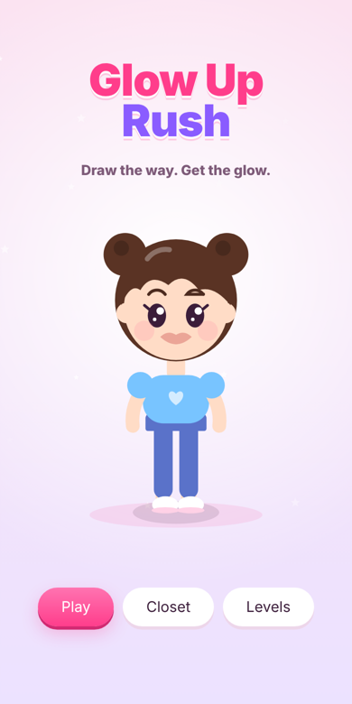
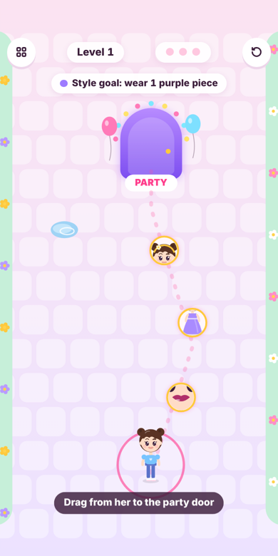
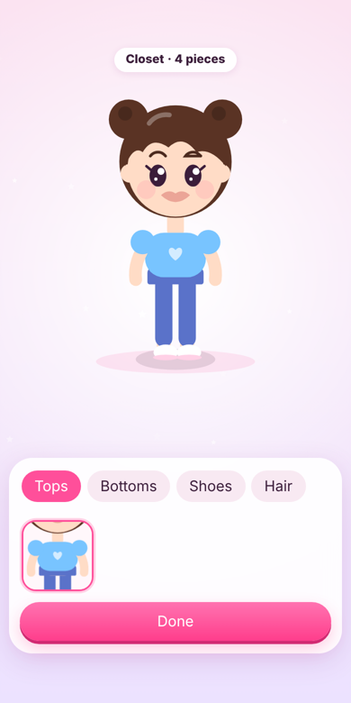

# Glow Up Rush

**Draw the way. Get the glow.**

A casual mobile web game built for **YouTube Playables**: draw a path to guide the character to the party, collect outfit pieces along the way, then finish the look with a hands-on makeover before walking through the door.

<p align="center">
  
  
  
</p>

## Gameplay

- **Draw-to-move:** drag a line from the character to the party door. She walks your path and picks up every item she passes.
- **Obstacles:** puddles, hedges, a wandering cat, rain clouds and bees, unlocked gradually as levels get harder.
- **Hands-on makeover:** lipstick, blush and eyeshadow are applied by rubbing the tool over the face; a progress bar fills as coverage grows.
- **Wardrobe system:** 13 item categories (hair, tops, bottoms, dresses, shoes, accessories, makeup) with hundreds of colour variations. New finds are tagged and saved to the closet.
- **Style goals:** each level asks for a colour theme (for example "wear 2 purple pieces"), scored with up to 3 stars.
- **100 procedurally generated levels**, every one verified as solvable by an automated test.

## Technical highlights

| Area | Approach |
|---|---|
| Rendering | Plain HTML5 Canvas 2D, all art drawn in code (no image assets) |
| Levels | Seeded PRNG generates paths, items and hazards deterministically per level |
| Collision | Point-to-polyline distance checks for the drawn path and moving hazards |
| Makeover | Off-screen canvas painting clipped to `Path2D` face shapes, with sample-point coverage tracking |
| Item previews | Thumbnails rendered on the fly from the same character drawing code |
| Audio | Generated with the Web Audio API (no audio files) |
| Platform | YouTube Playables SDK: `firstFrameReady`, `loadData` → `gameReady`, cloud save via `saveData`, platform-controlled pause and audio; falls back to `localStorage` outside YouTube |
| Size | ~70 KB total, no frameworks, no external fonts or requests |
| Responsiveness | Scales to any aspect ratio and respects safe-area insets |

## Project structure

```text
src/
  index.html   page shell, loads the Playables SDK before game code
  style.css    UI overlay styles (menus, closet, HUD)
  game.js      game engine, level generator, character renderer, makeover tools
docs/          screenshots
```

## Tech stack

JavaScript (ES5, no build step) · HTML5 Canvas · Web Audio API · YouTube Playables SDK · Playwright (automated screenshots and level testing)

## Status

Gameplay complete. Ad placements and certification on real devices via the official Playables test suite are pending platform acceptance.

---

© 2026 yunalhoshi. All rights reserved. This repository is published for portfolio viewing only. See [NOTICE](NOTICE).
